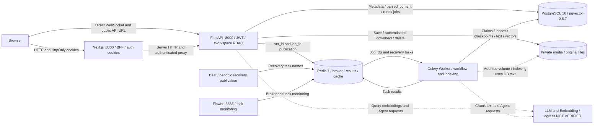

# AgentForge v0.13 — Atomic 1: Production Architecture Audit

Audit date: 2026-11-24. Status: local documentation prepared for maintainer review. No production fixes, completion declaration or production-readiness certification.

## 1. Scope and exact baseline

Repository: `D:/agent_project/agentforge`. Required and observed branch: `main`.
Required and observed HEAD and peeled `v0.12.0` tag: `6e4cca6bc188d829bc09431080b08ad86e37f3fb` (v0.12.0 — Knowledge Frontend).
Before writes, working tree and staged diff were empty and `git diff --check` passed. No baseline repair was needed.

Only this document and `docs/v0.13/roadmap.md` are authorized additions. Source, dependencies, lockfiles, migrations, deployment files, CI, tests and version metadata remain unchanged. Atomic 2 is not started.

Supplied historical baseline: [Main CI #197](https://github.com/WmsL2/agentforge/actions/runs/45356348423), SUCCESS, 16/16 jobs. This is user-supplied historical evidence, not independently retrieved run logs or new CI. Local tag resolution was verified; GitHub Release publication was not independently inspected. Older release-preparation wording is historical, not authoritative current publication status.

## 2. Review methodology and evidence classification

Reviewed tracked source through numbered `git show HEAD:<path>` reads, targeted excerpts, `git grep` and tracked-path inventory. Only public example configuration was read. Actual environment files, authentication storage and credentials were not inspected. No application module was imported, avoiding Settings dotenv loading. No runtime inspection or external service call occurred.

- **S — confirmed static defect:** contradiction or inadequate implementation visible in source; runtime consequences remain prospective.
- **C — configuration risk:** deployment-dependent behavior requiring a contract and runtime acceptance evidence.
- **U — unverified operational gap:** implementation/guidance may exist, but successful operational exercise is not established.

Historical CI/document results are attributed; test source establishes coverage intent, not new execution. References use repository-relative `path:line` or `path:start-end` at the audited commit. No potential runtime consequence is reported as an observed failure.

### Required tracked files reviewed

| Area | Files |
| --- | --- |
| Guidance | `README.md`; `docs/architecture.md`; `docs/deploy.md`; `docs/configuration.md`; `ENV_VARS.md`; `docs/release-v0.9.md`; `docs/release-v0.11.md`; `docs/release-v0.12.md`; `docs/v0.12/atomic8-integration-release.md` |
| Deployment | `docker-compose.yml`; `docker-compose.frontend.yml`; `docker-compose.prod.yml`; `Makefile`; `backend/Dockerfile`; `frontend/Dockerfile`; `backend/.dockerignore`; `frontend/.dockerignore`; `backend/.env.example`; `frontend/.env.example` |
| API lifecycle | `backend/app/core/config.py`; `backend/app/core/logging.py`; `backend/app/core/middleware.py`; `backend/app/main.py`; `backend/app/db/session.py`; `backend/app/clients/redis.py`; `backend/alembic/env.py` |
| Health/tests | `backend/app/api/routes/v1/health.py`; `backend/app/api/routes/v1/__init__.py`; `backend/app/services/health.py`; `backend/tests/api/test_health.py`; `backend/tests/api/test_metrics.py`; `backend/tests/core/test_config.py` |
| Background | `backend/app/worker/celery_app.py`; `backend/app/worker/tasks/workflow.py`; `backend/app/worker/tasks/recovery.py`; `backend/app/worker/tasks/knowledge_index.py`; `backend/app/composition/workflow_worker.py`; `backend/app/composition/knowledge_index_worker.py`; `backend/app/integrations/celery/workflow_dispatcher.py`; `backend/app/integrations/celery/knowledge_index_dispatcher.py` |
| Knowledge | `backend/app/services/knowledge/document_storage.py`; `backend/app/services/knowledge/document_service.py`; `backend/app/services/knowledge/indexing_service.py`; `backend/app/services/knowledge/index_recovery.py` |
| Frontend/CI | `frontend/src/app/api/health/route.ts`; `frontend/src/lib/server-api.ts`; `frontend/src/lib/auth-cookies.ts`; `frontend/next.config.ts`; `.github/workflows/ci.yml` |

Additional targeted evidence: `backend/app/services/workspace/authorization.py`; `backend/app/api/deps.py`; `backend/app/core/security.py`; `backend/app/repositories/knowledge_document.py`; `backend/app/repositories/knowledge_index.py`; `backend/app/repositories/workflow/run/claim.py`; `backend/app/services/workflow/application/background/claim_service.py`; `backend/app/services/workflow/application/background/durability.py`; `backend/app/services/workflow/application/background/executor.py`; `backend/app/services/workflow/application/background/recovery_scanner.py`; `docs/v0.11/atomic8-integration-release-hardening.md`; `frontend/e2e/auth.setup.ts`; `frontend/e2e/knowledge-management.spec.ts`; `frontend/e2e/workflow-knowledge.spec.ts`. Storage/recovery tests were also located through tracked searches.

## 3. Current production architecture

The intended single-host deployment contains Next.js, FastAPI, PostgreSQL/pgvector, Redis, Celery Worker, Beat and Flower. These are runtime roles of one application. Web Engineering Foundation and custom Agent Platform Core remain distinct (`README.md`, `docs/architecture.md`). The diagram describes source wiring and intended data flow, not a verified running deployment.

All production services attach only to `backend-internal` (`docker-compose.prod.yml:225-228`). API, frontend and Flower publish host ports; DB and Redis do not. Dotted provider arrows are intended calls, not reachability evidence. The shared media mount contains private originals; **KnowledgeIndexExecutor consumes PostgreSQL `parsed_content`**, not a necessary reread of original files (`backend/app/services/knowledge/indexing_service.py:170-193`).

## 4. Development versus production configuration

| Concern | Development | Production source |
| --- | --- | --- |
| Topology | Backend Compose; frontend normally host Bun | Backend and frontend containers |
| Code/image | Read-only source mounts, reload, dev image tag | No backend source mount; API build lacks explicit shared image tag |
| Environment | API local, debug true | API production/debug false; Worker/Beat lack explicit environment override |
| Env input | `backend/.env` | Same path; make prod also uses it for Compose interpolation |
| Ports | Includes DB/Redis host ports | DB/Redis internal; API/Frontend/Flower host ports |
| Health overrides | Worker ping, Beat disabled, Flower status-aware check | These overrides absent |
| Resources | Development defaults | Existing per-service deploy resource limits; enforcement NOT RUN |

Evidence: `docker-compose.yml:5-177`; `docker-compose.frontend.yml:1-69`; `docker-compose.prod.yml:13-223`; `Makefile:164-170`. Frontend verification Compose is not the full production stack. Fixed names and project-derived volumes require deliberate environment isolation; persistence alone does not prove separation.

## 5. Container images and service dependencies

Preserve multi-stage Docker builds, backend frozen uv installation, frontend frozen Bun installation, non-root `appuser`/`nextjs`, and standalone Next output (`backend/Dockerfile:3-46`; `frontend/Dockerfile:1-60`; `frontend/next.config.ts:61-63`). Frozen packages do not make floating builder/base tags (`uv:latest`, `oven/bun:1`, `python:3.12-slim`) immutable artifacts.

Production preserves `pgvector/pgvector:0.8.7-pg16-bookworm`, `redis:7-alpine` and named PostgreSQL/Redis/media volumes (`docker-compose.prod.yml:50-93,230-233`). API waits for DB/Redis health; Worker/Beat wait for API merely started and DB/Redis health; frontend waits for API start; Flower waits for API start and Redis health. No dependency gates migration success, provider egress or business readiness. Worker declares two replicas with concurrency four; actual capacity/enforcement is unmeasured.

API build lacks an image field; Worker/Beat/Flower reference `agentforge_backend:dev`. Source does not guarantee matching release code. No Docker build, image inspection, effective Compose rendering or deployment was run.

## 6. Application startup, shutdown and migrations

`lifespan` constructs Redis, opens the tool platform, and closes Redis/database in finally (`backend/app/main.py:34-52`). `RedisClient.connect` constructs a client using from_url without pinging (`backend/app/clients/redis.py:26-32`); startup alone does not prove connectivity. `_managed_session` commits on success and rolls back on error; `close_db` disposes the engine (`backend/app/db/session.py:29-101`). Existing worker contexts use task-local NullPool engines and disposal, including workflow/index composition (`backend/app/composition/workflow_worker.py:38-113`; `backend/app/composition/knowledge_index_worker.py:16-46`). Graceful deployment termination remains unverified.

Alembic reads Settings.DATABASE_URL_SYNC and uses a separate sync connection (`backend/alembic/env.py:43-80`). Release/CI source identifies baseline head `0046_add_workflow_run_actor_identity`; no live DB revision was queried. make prod starts all services, sleeps five seconds, then migrates; docker-prod omits migration (`Makefile:164-170,372-375`). Migration failure cannot prevent access by already-started business processes. Atomic 3 must gate business startup on one successful migration; Atomic 5 validates recovery.

## 7. Runtime configuration and secret handling

Reuse Settings rather than introducing another configuration framework. Existing dotenv discovery, empty-value handling, environment literals, JWT/API default checks, production wildcard-CORS rejection and positive lease/chunk/provider timeout constraints are real capabilities (`backend/app/core/config.py:11-37,45-202`), not a complete production contract.

API RedisClient uses computed REDIS_URL, whereas Celery uses distinct CELERY_BROKER_URL/CELERY_RESULT_BACKEND. P0-01 concerns API-side Celery publication, not all API Redis access. Production Compose overrides its Celery URLs with unauthenticated forms.

DB/Redis computed URLs and Compose Celery URLs interpolate credentials directly. Synthetic reserved-character encoding tests are needed. Settings defaults PostgreSQL password empty and the example uses postgres; production Compose has no postgres password fallback but lacks a required-value guard. Redis/Flower Compose guards reject missing/empty values; nonempty public placeholders still pass those guards.

LLM_* configures Platform Runtime, OPENAI_API_KEY is legacy template chat, and EMBEDDING_* is separate. Required credentials/model/base URL must follow enabled capabilities. Provider metadata is not connectivity. NEXT_PUBLIC_* values are build-time browser configuration; BACKEND_URL is server-side (`frontend/Dockerfile:21-38`; `frontend/src/lib/server-api.ts:7-65`). Secrets must not enter public build args.

`ENV_VARS.md:70-75` recommends dumping Settings and overstates required-field validation. Computed credential URLs make this unsafe; it was not executed. Safe validation should report bounded field names/codes without values or raw validation inputs.

## 8. Health, readiness, logging and metrics

Preserve basic health, live, ready and legacy ready alias. Basic health returns healthy plus max_upload_size_mb. Live returns alive, timestamp/service/details. Readiness runs SELECT 1 and Redis ping, returns 503 on critical DB/Redis failure, and includes checks plus top-level service entries (`backend/app/api/routes/v1/health.py:24-168`; `backend/app/services/health.py:9-23`). Worker/LLM checks are configuration-only and do not determine readiness. Live uses a VERSION fallback of 1.0.0, not reliable release-identity evidence.

Some readiness errors expose str(e); safe bounded codes/protected diagnostics are needed. Redis's normal ping wrapper returns false on exceptions, but raw-error branches remain. Next `/api/health` proxies backend basic health, not worker/provider readiness (`frontend/src/app/api/health/route.ts:5-14`). Backend Docker healthcheck ignores HTTP status. Production role services lack overrides; actual inheritance depends on the referenced image. Frontend production lacks an explicit check, unlike verification Compose.

RequestIDMiddleware propagates/generates X-Request-ID and stores request state (`backend/app/core/middleware.py:12-27`); this does not automatically correlate every log/task. Bound/trust inbound IDs. setup_logging installs PiiRedactionFilter on the root logger, not handlers (`backend/app/core/logging.py:48-74`; `backend/app/main.py:108`). Python ancestor logger filters do not process records propagated from descendants. Where called, this filter rewrites string messages/args, not arbitrary extra/nested fields, exc_info or formatted traceback text. Complete redaction is not established. No explicit worker setup_logging invocation was found. Preserve the filter and test effective handler/formatter/worker coverage. Prometheus is disabled (`backend/tests/api/test_metrics.py:1`); RunStep/Trace is not an operational metrics endpoint.

## 9. Workflow background execution and recovery

CeleryWorkflowDispatcher.dispatch publishes run_id via asyncio.to_thread; task validates UUID and opens open_workflow_worker (`backend/app/integrations/celery/workflow_dispatcher.py:17-28`; `backend/app/worker/tasks/workflow.py:17-49`). PostgreSQL runs, immutable definition snapshots and checkpoints are recovery truth; broker messages are not business state.

BackgroundRunExecutor, WorkflowExecutionClaimService, BackgroundRunDurability and the claim repository implement short transactions, token/generation/expiry fencing and checkpoint-aware resume (`backend/app/services/workflow/application/background/executor.py:34-174`; `backend/app/services/workflow/application/background/durability.py:95-129`; `backend/app/repositories/workflow/run/claim.py:26-31,155-168`). Cancellation/infrastructure errors retain leases for expiry recovery; only persisted terminal/pause outcomes permit best-effort release. Workflow has no automatic heartbeat; knowledge indexing does.

WorkflowRecoveryScanner.scan_once releases selection locks before bounded publication; selection scheduling and claims guard redelivery (`backend/app/services/workflow/application/background/recovery_scanner.py:23-68`). Beat schedules scans, workers execute them (`backend/app/worker/celery_app.py:34-43`; `backend/app/worker/tasks/recovery.py:13-26`). JSON, late acknowledgements, reject-on-worker-lost and prefetch one exist (`backend/app/worker/celery_app.py:22-32`). Delivery is at-least-once; provider/tool effects are not guaranteed exactly once (`docs/release-v0.9.md:60-66`). Atomic 5 must reuse these mechanisms.

## 10. Knowledge indexing and recovery

KnowledgeIndexingService.request_index authorizes KNOWLEDGE_EDIT, requires parsed content, creates an idempotent pending job, commits before dispatch and leaves publication failures recoverable (`backend/app/services/knowledge/indexing_service.py:61-93`). Dispatcher sends job_id; executor claims a lease, loads PostgreSQL parsed_content, checks hash/configuration, chunks/embeds outside the source-read transaction and commits a fenced generation (`:162-212`). Index heartbeat renews the lease during embedding (`:214-245`).

Parsed content is persisted in `backend/app/repositories/knowledge_document.py:38`; shared original media does not imply rereads for indexing. complete_job changes active generation under fencing; failed reindex does not automatically destroy the old index (`backend/app/repositories/knowledge_index.py:176-246`). KnowledgeIndexRecoveryScanner publishes bounded pending/expired work and counts outcomes (`backend/app/services/knowledge/index_recovery.py:19-48`); Beat scheduling already exists. Preserve these capabilities and bounded chunk/provider settings.

## 11. Private document storage and consistency

KnowledgeDocumentStorage sanitizes names, rejects absolute/traversal/symlink paths, checks containment, writes exclusively with flush/fsync and removes failed partial files (`backend/app/services/knowledge/document_storage.py:16-113`). KnowledgeDocumentService authorizes workspace access, limits uploads to 10 MiB, bounds parsing time/concurrency, saves originals before metadata commit, compensates failed commits and deletes metadata before best-effort file cleanup (`backend/app/services/knowledge/document_service.py:23-25,49-107,159-184,219-243`). These protections exist.

Orphan reconciliation already loads all DB storage paths, walks knowledge files and unlinks non-live paths (`backend/app/services/knowledge/document_service.py:180-184`; `backend/app/services/knowledge/document_storage.py:115-129`; `backend/app/repositories/knowledge_document.py:94`). Tracked application search found the methods, not an established scheduled production invocation. A concurrent upload saved before metadata commit may be missing from the inventory. Future safe invocation needs backup, quiescence/locking of all media/metadata writers, consistent all-workspace inventory and reviewable dry-run candidates. These are required safeguards, not existing features. Do not implement competing cleanup or execute reconciliation here.

Paired DB/media backup guidance exists (`docs/v0.11/atomic8-integration-release-hardening.md:19`; `docs/release-v0.12.md:25`). A verified runbook must define RPO/RTO, retention/encryption/access, schema/file/hash inventory, isolated restore, auth/download/vector checks, pending-run/job handling and resume criteria. No successful drill is supplied. Named volumes and fsync are neither backups nor atomic DB/filesystem transactions.

## 12. Authentication, authorization and network boundaries

JWT verification/active-user checks exist (`backend/app/api/deps.py:420-445`; `backend/app/core/security.py:41-50`). API key verification is separate (`backend/app/api/deps.py:607-631`), not universal workspace authorization. WorkspaceAuthorizationService returns 404 for nonmembers and 403 for insufficient member permissions (`backend/app/services/workspace/authorization.py:25-51`). Document lookups are workspace/base scoped; global administration does not grant membership.

Frontend cookies preserve HttpOnly, production-default Secure, SameSite=Lax and path `/` (`frontend/src/lib/auth-cookies.ts:20-54`). COOKIE_SECURE=false is an explicit exception. Production Compose defaults public URLs to HTTP/WS with Secure cookies and supplies no TLS proxy. API CORS and frontend security headers exist (`backend/app/main.py:151-157`; `frontend/next.config.ts:17-83`), but deployed origin/proxy/WebSocket security is unverified.

Atomic 6 must specify TLS termination, trusted proxies, HTTPS/WSS URLs, cookie/CORS policy and restricted API/Flower/health exposure. Internal DB/Redis attachment does not prove firewall/host routing/provider egress. Private build context/volume protection and bounded resource/provider spend controls remain required.

## 13. Existing tests and CI evidence

Health tests cover mocked DB/Redis failures and config-only provider semantics (`backend/tests/api/test_health.py:12-115`). test_config covers MCP and positive workflow lease constraints, not a full production secret/URL contract. test_metrics contains only the disabled comment.

CI retains real PostgreSQL/Redis/Celery workflow and knowledge lifecycle jobs, frontend component/browser checks, security and backend image build (`.github/workflows/ci.yml:94-1204`). Knowledge/Workflow browser fixtures exercise real pages with synthetic domain HTTP responses; real auth setup does not turn mocked operations into worker/provider E2E. CI frontend uses bun run dev, not its production image (`:1107-1115`). Backend deterministic providers do not prove commercial availability/quality.

`docs/v0.12/atomic8-integration-release.md` contains chronological local review/repair records, including earlier NOT RUN browser execution. Supplied later Main CI #197 SUCCESS is historical aggregate evidence, not freshly inspected individual logs/counts. No new CI ran. Backend-only Docker CI and Trivy exit-code 0 establish neither full production viability nor absence of vulnerabilities.

## 14. Prioritized findings and remediation mapping

Atomic owners refer to `docs/v0.13/roadmap.md`. Impacts below are potential, never observed runtime failures. Future acceptance evidence is not executed by this Atomic.

### P0 — deployment blockers

| ID / severity / class | Source evidence and existing behavior | Potential impact | Remediation / responsible Atomic | Expected acceptance evidence |
| --- | --- | --- | --- | --- |
| P0-01 / P0 / S | `docker-compose.prod.yml:27-28,77,106-107,138-139`; API Celery URLs omit auth while Redis requires auth and Worker/Beat authenticate. `backend/app/worker/celery_app.py:10-13` consumes those URLs. | API task publication/result access may be rejected; durable work may await recovery. | A2 coherent broker/backend configuration; A3 deploy wiring. | Synthetic authenticated Redis publication/consumption/results across API and Worker; A7 deployed workflow/indexing proof without secret output. |
| P0-02 / P0 / S | `docker-compose.prod.yml:13-16,95-96,128-129,156-157`; API build has no image tag matching Worker/Beat/Flower dev image. | Fresh host may lack image or run stale/different worker code. | A3 one versioned release image/digest for backend roles. | Clean isolated build/render/image-identity inventory; all roles use same artifact and expected registered tasks. |
| P0-03 / P0 / C | `docker-compose.prod.yml:30-31,108-109,212-213,225-228`; only internal network, no explicit provider egress path. | External LLM/Embedding calls may be unreachable. | A3 controlled provider egress; A6 exposure policy. | A7 DNS/TLS/egress test to deterministic provider outside internal network; DB/Redis remain restricted. Commercial test separately authorized. |
| P0-04 / P0 / S | `Makefile:164-170`; up, sleep 5, then migrate. `docker-compose.prod.yml:34-38,110-116` gates health, not schema. | API/workers can access old/partial schema before migration succeeds. | A3 migration-success gate before business startup. | Isolated cold-start and failed-migration proof that business roles never accept work/start before successful migration; revision evidence. |

### P1 — operational and security gaps

| ID / severity / class | Source evidence and existing behavior | Potential impact | Remediation / responsible Atomic | Expected acceptance evidence |
| --- | --- | --- | --- | --- |
| P1-01 / P1 / C | `docker-compose.yml:19-20`; `docker-compose.prod.yml:6-8,20-21`; same backend env input. | Dev/prod secret or endpoint crossover. | A2 isolated explicit environment inputs; reuse Settings. | Synthetic dev/prod resolution cases without value dumps; A3 resource isolation contract. |
| P1-02 / P1 / C | `backend/app/core/config.py:53-57,81-119,193-202`; `backend/.env.example:16,99-102`; `docker-compose.prod.yml:55,77,167`. JWT/API/CORS checks exist; production completeness/placeholder validation is incomplete. | Insecure placeholders or missing enabled-feature configuration can survive preflight. | A2 capability-aware production contract, including Providers and safe errors. | Positive/negative required/placeholder/empty setting cases across API/Worker/Beat; diagnostics exclude secret values/input. |
| P1-03 / P1 / S | `backend/app/core/config.py:61-75,128-132`; `docker-compose.prod.yml:106-107`; unescaped credential interpolation. | Reserved characters may alter URL parsing/authentication. | A2 URL-safe builders/encoding for DB, Redis, Alembic and Celery. | Synthetic reserved-character round-trip tests for async/sync DB and Redis broker/backend, no real credentials. |
| P1-04 / P1 / C | `docker-compose.prod.yml:24,102-107,134-139`; `backend/.env.example:7`; Settings defaults local. | Worker/Beat may bypass production validators if env input is local. | A2 consistency contract; A3 explicit environment on each role. | Sanitized role identity check and same production validation behavior across roles. |
| P1-05 / P1 / C | `docker-compose.yml:10,43,64,119,147`; `docker-compose.prod.yml:17,52,76,130,158,202`; fixed names overlap. | Name collisions or operations against unintended environment resources. | A3 project-scoped names/networks/volumes/ports. | Two isolated rendered identity inventories and authorized coexistence proof. |
| P1-06 / P1 / S | `backend/Dockerfile:51-52`; httpx.get ignores status. | HTTP 500/503 can leave container marked healthy. | A4 status-aware probe with bounded timeout and truthful endpoint. | Probe fails on non-2xx, timeout/unreachable and passes on intended response. |
| P1-07 / P1 / C | `backend/Dockerfile:51-52`; production role blocks `docker-compose.prod.yml:95-182` omit overrides; development has role checks at `docker-compose.yml:105-177`. | Images built from this Dockerfile pass irrelevant port-8000 probe to non-API roles, possibly reporting unhealthy. | A4 role-specific Worker/Flower checks and explicit Beat semantics; A3 image identity prerequisite. | Effective image/container healthcheck inspection plus role failure injection. No effective render/inspect performed here. |
| P1-08 / P1 / S | `frontend/Dockerfile:41-60`; `docker-compose.prod.yml:184-223`; no explicit frontend check. Verification Compose has one at `docker-compose.frontend.yml:58-69`. | Missing declared frontend container health signal. | A4 reuse frontend health endpoint and bounded status-aware Bun probe. | Production frontend success/failure/timeout cases with backend dependency semantics documented. |
| P1-09 / P1 / C | `backend/app/api/routes/v1/health.py:81-150`; DB/Redis real, Worker/LLM config-only, only DB/Redis critical. | Configured status mistaken for worker/provider connectivity. | A4 truthful configured/connected semantics; no routine paid probe. | Health contract and authorized worker-failure checks; configuration never presented as live provider success. |
| P1-10 / P1 / S | `backend/app/api/routes/v1/health.py:90-114`; raw exception text in readiness. | Internal/connection details may leak. | A2 safe errors; A4 health integration. | Synthetic sensitive errors yield bounded public codes and protected/redacted diagnostics. |
| P1-11 / P1 / U | `backend/tests/api/test_metrics.py:1`; Prometheus disabled; existing RunStep/Trace is execution observability. | Minimal quantitative operational/recovery signals absent. | A4 minimal protected low-cardinality metrics, reuse counters/events. | Access/cardinality/redaction checks and deterministic failure/recovery signal proof; no monitoring platform required. |
| P1-12 / P1 / S | `backend/app/core/logging.py:48-74`; root logger filter rewrites string msg/args only; installation at `backend/app/main.py:108`. | Descendant logs, traceback and structured fields may evade redaction. | A4 reuse filter with effective handler/formatter and worker coverage. | Captured root/descendant/handler/Celery/exception/nested-field synthetic secret tests. No complete-redaction claim now. |
| P1-13 / P1 / U | `docs/v0.11/atomic8-integration-release-hardening.md:19`; `docs/release-v0.12.md:25,65`; guidance exists, successful drill not supplied. | Mismatched or unrecoverable DB/private media. | A5 paired backup/restore runbook and isolated drill; A8 handoff. | Authorized restore inventory/schema/vector/document hash/download checks, pending recovery evidence and measured RPO/RTO. |
| P1-14 / P1 / C | `backend/app/services/knowledge/document_service.py:180-184`; `backend/app/services/knowledge/document_storage.py:115-129`; existing reconciliation lacks writer exclusion in this method. | In-flight uncommitted upload may appear orphaned to snapshot. | A5 safe maintenance invocation/quiescence/locking/candidate review using existing reconciliation. | Authorized isolated concurrent-upload/commit-failure maintenance tests; valid files preserved; no competing cleanup. |
| P1-15 / P1 / C | `docker-compose.prod.yml:32-33,170-171,197-211,214-215`; direct API/Flower/frontend ports, HTTP/WS defaults. | Excess exposure and Secure-cookie/TLS mismatch. | A6 TLS/proxy/Cookie/CORS/network policy; A3 wiring. | Authorized HTTPS/WSS auth flow, restricted Flower/health, trusted-proxy checks and published-port inventory. |
| P1-16 / P1 / C | `backend/.dockerignore:1-57`; `backend/Dockerfile:21,36-37`; no explicit media/data/model-cache exclusions. | Private artifacts, if present in context, may enter image layers. | A6 build-context/private-artifact exclusions. | Synthetic marker context/layer exclusion proof without reading actual private data; required runtime files preserved. |
| P1-17 / P1 / C | `backend/app/core/config.py:49-51`; storage soft cap explicitly unenforced. `docker-compose.prod.yml:40-47,118-126` already declares resource limits; upload/parser/chunk controls also exist. | Disk/queue/provider spending may grow beyond intended limits. | A6 bounded storage/queue/concurrency/request/time/spend controls; A4 signals. Billing redesign excluded. | Deterministic overload/limit/error tests, resource enforcement evidence; separate commercial spend authorization. |

### P2 — documentation and verification gaps

| ID / severity / class | Source evidence and existing behavior | Potential impact | Remediation / responsible Atomic | Expected acceptance evidence |
| --- | --- | --- | --- | --- |
| P2-01 / P2 / S | `docs/deploy.md:16-27`; staging/production example starts default development Compose then migrates. | Development debug/mount/exposure settings deployed. | A3 validated production commands; A8 docs alignment. | Command-to-file/config review plus later isolated deployment evidence. |
| P2-02 / P2 / S | `docs/deploy.md:132` says ok; `backend/app/api/routes/v1/health.py:34-37` says healthy plus upload limit. | Incorrect scripted checks. | A4 health examples; A8 docs. | Examples match schema/response contract tests. |
| P2-03 / P2 / S | `Makefile:170` references absent nginx/nginx.conf; no nginx file found in tracked tree. | Referenced deployment config unavailable. | A6 supported proxy configuration/policy; A8 dangling-reference cleanup. | Every documented operational file exists and proxy behavior verified under authorization. |
| P2-04 / P2 / U | `.github/workflows/ci.yml:1177-1196`; Docker job builds backend only. | Image build misread as full-stack production certification. | A7 deployment evidence; A8 separate gates. | Production-image/Compose runtime matrix with artifact/resource identities. |
| P2-05 / P2 / C | `.github/workflows/ci.yml:1198-1204`; Trivy exit-code 0, HIGH/CRITICAL. | Successful job mistaken for vulnerability-free image. | A6 explicit vulnerability triage/gate policy; A8 evidence. | Actual findings/dispositions and gate behavior, preserving existing security checks. |
| P2-06 / P2 / U | `docs/release-v0.12.md:45,49-65`; live full-stack staging NOT RUN. | Deployed integration unproven. | A7 isolated deterministic-provider staging. | Real auth/frontend/API/DB/worker document/index/retrieval/workflow/approval/revocation/recovery proof. |
| P2-07 / P2 / U | `docs/release-v0.11.md:30`; deterministic provider is not commercial availability/quality evidence; no supplied commercial result. | Provider compatibility/reachability/cost assumptions unverified. | A7 separately authorized optional commercial smoke; A8 disclose status. | Endpoint/model/data/budget approval and bounded evidence; otherwise NOT RUN. |
| P2-08 / P2 / U | `docs/release-v0.12.md:25,65,74`; DB/media restore drill NOT RUN. | Recovery readiness overstated. | A5 drill; A7 staging acceptance; A8 evidence. | Paired restore integrity/auth/recovery proof and resume criteria; see P1-13. |
| P2-09 / P2 / S | `ENV_VARS.md:33,56,70-75` treats URLs as required inputs and recommends Settings dump; `backend/app/core/config.py:59-75,126-138` computes DB/Redis URLs and separates Celery. | Wrong configuration and secret-bearing diagnostics. | A2 safe configuration contract; A8 reference cleanup. | Examples match input/computed fields and diagnostics disclose no values. |

### Corrections and qualifications

P0-03 is an internal-network configuration risk, not an observed provider outage. P0-01 does not mean computed API RedisClient URL lacks authentication. P1-02: production PostgreSQL interpolation has no postgres fallback; that value is in the public development example, while Settings defaults empty. Redis/Flower nonempty guards exist. P1-07 is conditional image inheritance, not inspected runtime state; development overrides already exist. P1-09 preserves real DB/Redis checks. P1-12 preserves an existing filter but rejects complete coverage. P1-13/P1-14 preserve backup guidance/reconciliation while identifying missing operational evidence and safeguards. P1-17 preserves existing resource declarations and parser/index limits. P2-09 is additional locally verified documentation drift. No contradiction was hidden and none authorizes source changes in this Atomic.

## 15. Production verification boundaries

| Layer | Existing evidence and limit | This Atomic |
| --- | --- | --- |
| Unit/integration | Tracked tests/historical local records; mocked checks do not deploy services. | NOT RUN |
| Browser HTTP mock integration | Real browser/pages/auth setup with synthetic domain fixtures; supplied historical CI aggregate only. | NOT RUN |
| Real backend integration E2E | Real PostgreSQL/pgvector/Redis/Celery CI jobs and deterministic providers, separate from browser fixtures. | NOT RUN |
| Backend Docker image build | Backend-only CI job; historical supplied aggregate, no new build. | NOT RUN |
| Production Compose runtime | Requires effective config/image/migration/network/probe/persistence evidence; independent CI layers do not establish it. | NOT RUN |
| Live full-stack staging | Full deployed auth/frontend/API/DB/worker path on explicitly authorized isolated resources. | NOT RUN |
| Commercial Provider smoke | Separate endpoint/model/data/spend authorization; deterministic provider is insufficient. | NOT RUN |
| Database/media restore drill | Isolated paired restore and integrity/recovery proof required. | NOT RUN |
| Documentation/static validation | Baseline, source, headings, finding IDs, tracked paths, roadmap, whitespace and Git scope. | Performed locally; implementation report records results |

No Docker start/stop/restart/build/Compose execution, WSL startup, migration, DB connection, Provider call, media mutation or reconciliation occurred. No new CI or production deployment success is claimed.

## 16. Recommended v0.13 scope and non-goals

Confirmed roadmap: audit → configuration/secrets → deployment → operational observability → reliability/recovery → security → isolated staging → integration/release. Address P0 configuration/deployment blockers before claiming deployability; later evidence gates remain mandatory.

Reuse Docker/auth/session/Settings/health/logging/worker/checkpoint/lease/recovery/storage/RBAC/test capabilities. Exclude Kubernetes, microservices, multi-agent orchestration, GraphRAG, hybrid retrieval, reranking, Agent Memory, billing redesign and redesigned platform core. Provider cost controls are bounded operational safeguards.

## 17. Atomic 1 acceptance and limitations

Local validation checks the 17 sections, P0-01–P0-04, P1-01–P1-17 and stable P2 IDs, eight roadmap definitions, tracked reference paths/line bounds, whitespace including untracked Markdown, empty staged diff, unchanged tracked files/branch/HEAD and exactly two authorized additions. Actual results are recorded in the implementation report.

Validation result: PASS for 17 sections, 30 unique finding rows (4 P0, 17 P1, 9 P2), and eight Atomics with all eight required fields. Checked 65 distinct repository-file references and 107 explicit path/line reference tokens against tracked paths and line bounds. The descriptive runtime input path backend/.env is not a tracked evidence reference and was never opened. Separate untracked-file whitespace checks and git diff --check passed; staged diff was empty; no tracked file changed; main/HEAD/tag remained exact; only the two authorized new Markdown files were present. These are static documentation checks, not runtime tests.

Executed command families: Get-Content for the request attachment and AGENTS.md; Get-Location; rg --files discovery; git rev-parse, branch --show-current, status, diff --cached --stat, diff --check, show HEAD:<path>, ls-files and grep; inline Python via PowerShell here-strings for numbered/selected source reads and static documentation validation; apply_patch for the two authorized files. Final checks use git diff --name-only, git ls-files --others --exclude-standard and git diff --cached --quiet. One oversized attempted Python document-write command failed before process launch; it changed no file and was replaced with apply_patch.

Changes remain local and unstaged for ChatGPT/maintainer review. No branch creation/switch, add, commit, push, merge, reset, stash, rebase, PR, tag, Release or remote mutation occurred. Runtime checks remain NOT RUN. Atomic 1 is not declared COMPLETE; Atomic 2 is not started.
