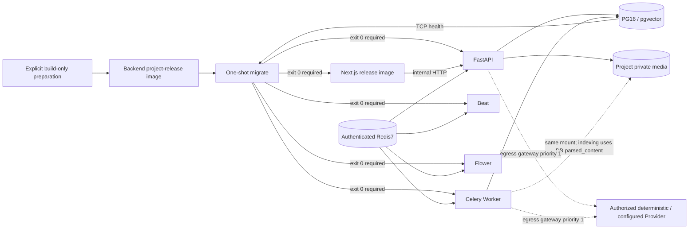

# AgentForge v0.13 — Atomic 3: Deployment Infrastructure

Date: 2026-11-26. Local implementation for review; no runtime authorization,
Final Source Review PASS, real deployment PASS or Atomic 3 COMPLETE declaration.

## 1. Objective and exact baseline

Make the existing single-host Compose deployment explicitly versioned, isolated
and migration-gated without redesigning the Foundation/Agent Platform Core.
Verified D:/agent_project/agentforge, main, HEAD
`71306978825e1c661392a7b510ecd71c0ffb95e8`, clean initial working tree, empty
staging and passing initial git diff --check. Historical v0.12.0 peeled tag is
`6e4cca6bc188d829bc09431080b08ad86e37f3fb`. Read AGENTS.md and accepted A1 audit,
roadmap and A2 implementation/review/security records. A2 COMPLETE, PR #41 merged,
PR CI #201 SUCCESS and Main CI #202 SUCCESS 16/16 are supplied historical evidence,
not newly retrieved CI results. No new CI or deployment was executed.

## 2. Actual source findings

Reconfirmed the 11 supplied facts locally: production API had build but no shared
image identity; Worker/Beat/Flower used dev tag; Make started before sleep/migration;
dependencies lacked a migration-success condition; fixed names collided with dev;
all services had only internal networking; Alembic uses DATABASE_URL_SYNC; both
Dockerfiles already had frozen multi-stage/non-root builds; shared HTTP healthcheck
could reach non-HTTP roles; main CI builds backend only; deploy.md recommended
development Compose. No source contradiction was hidden. Owning sources reviewed:
docker-compose.prod.yml, development Compose (unchanged), Makefile, both Dockerfiles,
backend/alembic/env.py, public production example, A2 configuration tests, deployment
and configuration docs, and existing deterministic knowledge lifecycle test handler.

## 3. Before/after architecture

Before: dev-tag workers, independently built API, one internal network, fixed
names/host ports, services launched before migration. After: same runtime roles
plus migrate, one shared backend release artifact, explicit project resources,
direct success gates and explicit API/Worker egress. Source topology, not runtime proof:



DB/Redis/Beat/Flower/migrate/frontend remain internal-only. Dotted Provider paths
are intended reachability, NOT RUN. Frontend calls API internally; browser URLs
are separate public build configuration. No microservice/orchestration redesign.

## 4. Shared backend release image contract

x-backend-service binds app/Worker/Beat/Flower/migrate to exactly
`agentforge/${PROD_PROJECT}-backend:${RELEASE_ID}`, pull_policy never, common env
mapping and selected env_file. Only app owns the backend build. Frontend uses
`agentforge/${PROD_PROJECT}-frontend:${RELEASE_ID}`. Make rejects dev/latest release
IDs and malformed/missing identities. Project suffix is limited to 40 lowercase
alphanumeric/hyphen characters; release is 1–64 alphanumeric/dot/underscore/hyphen,
starting alphanumeric. Project is a repository component; release is a separate Docker tag. This avoids
ambiguous hyphen concatenation between two valid project/release pairs.

Production requires PYTHON_IMAGE, UV_IMAGE, BUN_IMAGE, POSTGRES_IMAGE and REDIS_IMAGE
explicitly; no mutable default is silently selected by production Compose. Dockerfile
defaults remain python:3.12-slim, ghcr.io/astral-sh/uv:latest and oven/bun:1 for
development/old CI compatibility. Production operators select verified digests and
compatible runtime families; no registry digest was invented or resolved here.
uv binary gets its own source stage, both Python stages use the same ref; frozen
installation/non-root users remain. No dependency, lockfile or version change;
virtualenv 21.14.13 remediation is preserved. No bit-for-bit reproducibility claim.

## 5. Migration gate

migrate uses the same image/common production environment and direct
`alembic upgrade head`, existing env.py/revisions, only DB health dependency,
restart no and disabled inherited HTTP probe. PostgreSQL readiness explicitly
targets TCP 127.0.0.1 plus configured user/database/port, excluding temporary
initialization socket-only readiness. It does not prove authentication/schema;
migration must connect and succeed. Redis uses the same password/port as backend,
REDISCLI_AUTH and a bounded healthcheck requiring both CLI success and exact PONG,
without printing passwords. Existing probe interval/timeout/retries remain.

Every business role directly requires service_completed_successfully for migrate
plus DB/Redis health; frontend additionally waits for API start. Failed migration
cannot satisfy that declared condition. No fixed sleep, swallowed migration error
or API exec substitute. Actual engine enforcement still requires the runtime plan.
See [official startup conditions](https://docs.docker.com/compose/how-tos/startup-order/).

## 6. Fresh deployment and update sequence

GNU Make/POSIX shell is the supported interface; serialize operations under one
maintainer. No concurrency lock/transactional deploy guarantee is claimed.

1. Validate PROD_PROJECT/RELEASE_ID and readable non-symlink private production file;
   reject development .env, examples and missing/malformed inputs before Docker calls.
2. Canonicalize selected path (cygpath on Git sh where available) and export it.
3. Check Compose >=2.33.1 and run selected project's config --quiet, never dump secrets.
4. Explicit build-only target pulls configured DB/Redis and builds app/frontend once;
   use a fresh release ID. Alternatively select artifacts prepared earlier.
5. prod obtains config --images and inspects availability of all selected refs before
   touching containers. Application image pull policy and startup pull flag are never.
6. Refuse a currently running migration; stop only app/Worker/Beat/Flower/frontend
   in the selected project, but first execute the selected migrate image with
   run --rm --no-deps --pull never -T and a Settings-only Python import. Preflight
   failure exits before stop/rm/up; no dependencies, media, Alembic or connections.
   It can create project networks, requiring explicit authorization. Remove only
   its stopped migrate using rm --force, without
   stop or volume deletion options. Never adopt stale successful migration state.
7. up --detach --no-build --pull never starts infrastructure/fresh migrate and
   dependency-gates business startup. Nonzero failures stop the shell sequence;
   there is no automatic rollback/restart of old business services or success banner.

docker-prod aliases prod; down/log aliases share the same validation/scoping.
Build-only never starts services. Down preserves named volumes/images. No orphan,
volume or data cleanup occurs automatically. Manual docker start/restart/ad hoc
Compose can bypass the supported path and are outside its gate. A successful
detached startup command is not full readiness/staging proof.

## 7. Project/image/network/port isolation

Explicit --project-name avoids directory-name inference. No production fixed
container_name remains; dev names are unchanged. Networks/volumes have no global
name/external declaration. Every role uses internal service DNS. API/Worker also
attach to a non-internal bridge with gw_priority 1, exceeding internal default 0.
Compose >=2.33.1 is checked before changes. This is bridge/default-route separation,
not hostname filtering or complete egress security. No host network/privilege.

API/Frontend/Flower bindings use explicit *_BIND_HOST/*_HOST_PORT inputs, default
127.0.0.1 and 8000/3000/5555. DB/Redis publish no host ports. Two deployment projects
need distinct configured host ports. NEXT_PUBLIC_* remain browser-reachable build
args only, BACKEND_URL=http://app:8000 internal and COOKIE_SECURE default true.
TLS/proxy/public-access policy is A6; no nginx configuration is claimed to exist.

## 8. Persistent storage contract

Project postgres_data → /var/lib/postgresql/data, redis_data → /data and media_data
→ /app/media retain mount destinations. API and Worker share that project's media
and the same backend appuser identity. Fresh named-volume copy/ownership must be
verified; existing old-project volumes are not silently adopted/copied/renamed/deleted.
Data migration needs separate authorization. Down never requests volume removal.
No production source bind mounts. Redis volume is not zero-loss persistence or a
backup. No backup/restore or private-media reconciliation implementation changed.
KnowledgeIndexExecutor still consumes PostgreSQL parsed_content, not necessarily files.

## 9. Role healthcheck inheritance

migrate/Worker/Beat/Flower explicitly disable the inherited API HTTP healthcheck.
This avoids false HTTP-role health without fabricating successful worker probes.
API probe behavior, frontend/Worker/Flower checks, Beat semantics, correlation,
redaction and operational metrics remain A4. Infrastructure probes needed for
the migration gate are in scope; real health/failure injection is NOT RUN.

## 10. Production configuration and commands

See authoritative [deployment guide](../deploy.md), [environment contract](../../ENV_VARS.md)
and [configuration reference](../configuration.md). Default private input is
backend/.env.prod; protected .env.prod.<id> variants are accepted. The same absolute
input feeds --env-file and backend env_file. Shell interpolation precedence is
preserved with shared credential mappings across all five backend roles/infra.
Atomic 2 canonical authenticated Celery URLs and production mode remain enforced.
Direct run-prod retains its earlier explicit production-file selection unchanged.

Operator commands (NOT executed against Docker in this task):

```sh
make docker-prod-build PROD_PROJECT=agentforge-prod-example RELEASE_ID=r1 PROD_ENV_FILE=backend/.env.prod
make prod PROD_PROJECT=agentforge-prod-example RELEASE_ID=r1 PROD_ENV_FILE=backend/.env.prod
make prod-logs PROD_PROJECT=agentforge-prod-example RELEASE_ID=r1 PROD_ENV_FILE=backend/.env.prod
make prod-down PROD_PROJECT=agentforge-prod-example RELEASE_ID=r1 PROD_ENV_FILE=backend/.env.prod
```

PROD_DOCKER defaults to docker; automated command-flow tests set an explicit absolute
temporary fake executable, guaranteeing no daemon fallback. Never override it in a
real rollout without review. Documentation no longer recommends stale cloud-template
URL injection/static Next hosting, development production commands, Settings dumps,
destructive schema rollback or nonexistent nginx config.

## 11. Exact changed files

docker-compose.prod.yml; backend/Dockerfile; frontend/Dockerfile; Makefile;
backend/.env.prod.example; backend/tests/core/test_config.py (deployment expectations
only, security assertions retained); new backend/tests/core/test_deployment_contract.py;
ENV_VARS.md; docs/configuration.md; docs/deploy.md; this new document. Eleven authorized
paths only. Accepted audit/roadmap/A2 records, Settings, dev Compose, CI, runtime,
tasks, schema/migrations, dependencies/lockfiles and version metadata are unchanged.

## 12. Automated static/offline tests

PyYAML contract checks cover image identity/build ownership/pull policy, required
base/infra refs, gate/one-shot/probes, common environment, no fixed names, networks,
storage, public bindings and frontend/private-build separation. Dockerfile source
checks preserve frozen/non-root/default/multi-stage properties.

Executable GNU Make tests use the installed Make and Git POSIX sh with a temporary
fake Docker absolute path. They record argv and inject failures in config, image
inspection, stop, migration removal, up, pull and build; validate abort/nonzero
propagation; repeat release changes; check aliases, no volume deletion/implicit
rebuild, invalid identity/file rejection before fake Docker, old tooling rejection,
and refusal to remove a running migrate. These test shell/command flow, not real
Docker migration enforcement. No real Docker command or daemon is invoked. Existing
configuration and direct run-prod security coverage remains in place.

## 13. Actual verification commands and results

Historical implementation evidence before Review Fix 1. Current review-fix results
are appended chronologically in section 18; these counts remain unchanged.

| Actual command/check | Result |
| --- | --- |
| Initial isolated pytest config + deployment contract selection | 200 passed, 54 existing Pydantic warnings, no failure/error/skip |
| Expanded focused selection after adding update/build-failure cases | 203 passed, 54 existing Pydantic warnings |
| Intermediate broader offline selection | 382 passed, 54 existing Pydantic json_encoders warnings |
| Final focused selection after migration-query failure propagation correction | 204 passed, 54 existing Pydantic warnings, 0 failures/errors/skips |
| Final isolated pytest tests/core tests/api/test_health.py tests/worker tests/knowledge tests/agent_runtime tests/composition -q --tb=short, explicit -p anyio.pytest_plugin | 383 passed, 0 failures/errors/skips; no additional warnings reported in this second pytest.main invocation in the same isolated process |
| .venv/Scripts/ruff.exe check app tests cli (cwd backend) | Exit 0; all checks passed |
| .venv/Scripts/ruff.exe format --check tests/core/test_config.py tests/core/test_deployment_contract.py | Exit 0; both files formatted |
| .venv/Scripts/ty.exe check (cwd backend) | Exit 0; two existing warnings in unchanged background durability/executor files |
| Static PyYAML/Dockerfile assertions and executable Make fake-command tests | Executed within passing pytest; GNU Make and Git POSIX sh were available; no skipped command-flow verification |
| Final git diff --check, untracked whitespace, allowed-scope/branch/HEAD/tag/staging assertions | PASS: 11 authorized paths only, resources/volumes and virtualenv 21.14.13 preserved, exact main/HEAD/tag unchanged and staging empty |

Existing venv Python ran the inline isolated pytest launcher. Focused arguments:
tests/core/test_config.py tests/core/test_deployment_contract.py -q --tb=short.
Tool inspection used Get-Command/Get-Item (never WSL bash), and source review used
Get-Content, rg and read-only Git. apply_patch/inline Python edited only authorized
files. Ruff initially reported a dict-literal style issue in the new test file;
targeted fix/format resolved it. No dependency installation or runtime command.
Final review also changed the running-migration query to an independent checked
assignment before testing emptiness, so a failed ps command cannot be masked by
the test expression. Added fake-command failure injection for that step and reran
both selections. No real migration/container inspection was performed.

Pytest launches repeat approved synthetic environment isolation before collection:
retain only Windows SYSTEMROOT/WINDIR/TEMP/TMP/PATH, clear inherited application env,
set ENVIRONMENT=local/AGENTFORGE_ENV_FILE=none, synthetic JWT/API/DB credentials,
loopback DB/Redis hosts, offline_no_connect DB, disable plugin autoload, then import
pytest and load only anyio.pytest_plugin. Temporary files contain synthetic data;
no repository private dotenv is discovered. Approved unsandboxed test execution
permits Windows asyncio socketpair and fake shell processes only, not real services.

## 14. Finding disposition

| Finding | Implementation/evidence | Still NOT RUN |
| --- | --- | --- |
| P0-02 | Shared project/release image, one build owner, explicit no-pull/startup-no-build contract; YAML/Make tests | Actual builds/image IDs/provenance |
| P0-03 | Internal plus non-internal egress, only API/Worker, gateway priority/minimum tooling gate | DNS/routes/host/deterministic Provider reachability |
| P0-04 | One-shot direct Alembic, every business role success-gated; stopped roles/fresh gate/failure propagation in fake Make tests | Actual migration success/failure and redeployment enforcement |
| P1-05 | Explicit production project, no fixed names, scoped volumes/networks/images and configurable loopback ports | Two live projects/coexistence/ownership/persistence |
| P2-01 | Authoritative production guide and consistent aliases/file/artifact/gate commands | Live operator execution of documented procedure |

Atomic 2 P0-01/P1-01/P1-04 remedies retained in shared five-role configuration and
existing security assertions, without claiming live authentication/deployment proof.

## 15. Revised isolated runtime verification manifest (Review Fix 1)

**NOT AUTHORIZED / NOT RUN.** This replaces the withdrawn host-wide listener and
developer-tree build proposal. No host listener, runtime directory, runtime dotenv,
Docker resource, image resolution or build is created by Review Fix 1. The earlier
test results are historical; the old runtime commands were never executed.

### 15.1 Approval manifest and collision checks

Approval must name the exact Docker context/host and verified immutable image refs
before any resource operation. Candidate compatible families remain Python 3.12
Debian slim, uv binary, Debian Bun, PG16/pgvector 0.8.7, Redis7. No digest is invented;
mutable candidates are not digest evidence. Resolve only after explicit permission.

Dedicated runtime root: **D:/agent_project/agentforge/.cache/atomic3-runtime-20261126**.
It must not exist at preparation start; collision means stop without deletion or
adoption. Subdirectories: source (clean exported repository), fixtures (test-only
script), control (overrides), evidence (hash/resource/results manifests). Expected
Compose location: root/source/docker-compose.prod.yml. All backend/frontend build
contexts are under source, never the developer backend/frontend trees.

| Resource | Project A | Project B |
| --- | --- | --- |
| PROD_PROJECT | agentforge-prod-a3a-20261126 | agentforge-prod-a3b-20261126 |
| RELEASE_ID | verify1 then verify2 | verify1 |
| Private input under source/backend | .env.prod.a3a-20261126 | .env.prod.a3b-20261126 |
| Invalid-input experiment | .env.prod.a3a-invalid-20261126 | none |
| DB | agentforge_a3a_verify | agentforge_a3b_verify |
| API / Frontend / Flower host ports | 18081 / 13001 / 15551 | 18082 / 13002 / 15552 |
| Bind address | 127.0.0.1 | 127.0.0.1 |
| NEXT_PUBLIC_API_URL | http://127.0.0.1:18081 | http://127.0.0.1:18082 |
| NEXT_PUBLIC_WS_URL | ws://127.0.0.1:18081 | ws://127.0.0.1:18082 |
| NEXT_PUBLIC_SITE_URL | http://127.0.0.1:13001 | http://127.0.0.1:13002 |
| CORS_ORIGINS | ["http://127.0.0.1:13001"] | ["http://127.0.0.1:13002"] |
| Backend image | agentforge/agentforge-prod-a3a-20261126-backend:verify1; agentforge/agentforge-prod-a3a-20261126-backend:verify2 | agentforge/agentforge-prod-a3b-20261126-backend:verify1 |
| Frontend image | agentforge/agentforge-prod-a3a-20261126-frontend:verify1; agentforge/agentforge-prod-a3a-20261126-frontend:verify2 | agentforge/agentforge-prod-a3b-20261126-frontend:verify1 |
| Internal network | agentforge-prod-a3a-20261126_backend-internal | agentforge-prod-a3b-20261126_backend-internal |
| Egress network | agentforge-prod-a3a-20261126_provider-egress | agentforge-prod-a3b-20261126_provider-egress |
| Volumes | agentforge-prod-a3a-20261126_postgres_data; agentforge-prod-a3a-20261126_redis_data; agentforge-prod-a3a-20261126_media_data | agentforge-prod-a3b-20261126_postgres_data; agentforge-prod-a3b-20261126_redis_data; agentforge-prod-a3b-20261126_media_data |
| Fixture service/container | provider-fixture / agentforge-prod-a3a-20261126-provider-fixture-1 | provider-fixture / agentforge-prod-a3b-20261126-provider-fixture-1 |
| Fixture endpoint | http://provider-fixture:19190/v1 | same DNS name inside B's separate egress network |
| Provider host ports | NONE | NONE |
| Read-only fixture script | fixtures/provider-a.py | fixtures/provider-b.py |
| Override | control/a.yaml | control/b.yaml |
| Migration-failure override | control/a-migration-failure.yaml | none |

FIXTURE_IMAGE must be an approved, already available local Python 3.12 image ID
or immutable ref (may reuse the approved PYTHON_IMAGE); no implicit build/pull.
All five base/infra refs plus FIXTURE_IMAGE, context/host, platform, budgets and
record retention need explicit values in the signed approval. Default COOKIE_SECURE
stays true; plain-HTTP image reachability is not browser cookie/auth certification.

Before eventual creation, inspect only approved context version/named-resource
labels and port occupancy. Confirm neither project prefix, listed images,
networks, six volumes, fixture containers nor host ports belong to another task.
Also check future :verify2 tags and generated one-off preflight container names.
Any collision stops preparation; do not remove/reuse resources to make it pass.

Permitted operations requested for later approval: tracked-file export/hash checks;
synthetic input/fixture/overlay creation under the runtime root; approved base/infra
resolution/pull; local builds; selected-image inspection; project network creation
(including preflight), one-off no-deps config imports/removal; synthetic DB migration,
failure injection and retry; scoped up/stop/down/logs/selected-field inspection;
fixture-only requests; synthetic auth/document/index/search/Ask; bounded DB/Redis
auth/isolation/persistence checks; fixture stop and controlled temporary-file cleanup.
No commercial endpoint, old data adoption, prune, volume deletion or publication.

### 15.2 Verifiable clean build export — plan only

Run only after approval, from the developer repository. Enumerate Git tracked
paths, overlay only the authorized nine modified tracked paths and two authorized
untracked paths, never copytree or glob the developer directory. Non-modified
tracked contents come from HEAD blobs. Exclude private/ignored artifacts even if
an unexpected tracked path would otherwise include one. Abort on symlinks/submodules,
out-of-root paths, scope drift or an existing destination. This concrete exporter
uses existing Python/Git only; do NOT run it during this review fix:

```python
from pathlib import Path, PurePosixPath
import hashlib, json, subprocess
repo = Path.cwd().resolve()
assert str(repo).replace('\\', '/') == 'D:/agent_project/agentforge'
runtime = repo / '.cache/atomic3-runtime-20261126'
assert not runtime.exists()
assert runtime.parent.resolve().is_relative_to(repo)
allowed = {
    'docker-compose.prod.yml', 'backend/Dockerfile', 'frontend/Dockerfile', 'Makefile',
    'backend/.env.prod.example', 'backend/tests/core/test_config.py',
    'backend/tests/core/test_deployment_contract.py', 'ENV_VARS.md',
    'docs/configuration.md', 'docs/deploy.md',
    'docs/v0.13/atomic3-deployment-infrastructure.md',
}
def git(*args): return subprocess.check_output(['git', *args], cwd=repo)
assert git('rev-parse', 'HEAD').decode().strip() == '71306978825e1c661392a7b510ecd71c0ffb95e8'
modified = set(git('diff', '--name-only').decode().splitlines())
new = set(git('ls-files', '--others', '--exclude-standard').decode().splitlines())
assert modified | new == allowed
assert len(modified) == 9 and len(new) == 2
assert not git('diff', '--cached', '--name-only')
tracked = {}
for entry in git('ls-files', '--stage', '-z').decode().split('\0'):
    if not entry: continue
    meta, path = entry.split('\t', 1)
    mode, blob, stage = meta.split()
    assert mode in {'100644', '100755'} and stage == '0'
    tracked[path] = blob
def permitted(path):
    parts = PurePosixPath(path).parts
    if any(p in {'.git', '.venv', 'venv', 'node_modules', '__pycache__', 'media',
                 'data', 'chroma_data', 'models_cache', 'logs', '.cache',
                 '.pytest_cache', '.ruff_cache', '.ty_cache'} for p in parts): return False
    name = parts[-1]
    if name.startswith('.env') and name not in {'.env.example', '.env.prod.example'}: return False
    return Path(name).suffix.lower() not in {'.db', '.sqlite', '.sqlite3', '.log'}
items = []
for relative in sorted(set(tracked) | new):
    assert not PurePosixPath(relative).is_absolute() and '..' not in PurePosixPath(relative).parts
    if not permitted(relative): continue
    if relative in modified | new:
        original = repo / relative
        assert not original.is_symlink() and original.is_file()
        original.resolve().relative_to(repo)
        data = original.read_bytes()  # only the 11 explicit authorized public-source paths
    else:
        data = git('cat-file', 'blob', 'HEAD:' + relative)
    items.append((relative, data))
source = runtime / 'source'
source.mkdir(parents=True)
hashes = {}
for relative, data in items:
    dest = source / relative
    dest.parent.mkdir(parents=True, exist_ok=True)
    dest.write_bytes(data)
    if relative in tracked:
        mode = git('ls-files', '--stage', '--', relative).decode().split()[0]
        dest.chmod(0o755 if mode == '100755' else 0o644)
    digest = hashlib.sha256(data).hexdigest()
    assert hashlib.sha256(dest.read_bytes()).hexdigest() == digest
    hashes[relative] = digest
evidence = runtime / 'evidence'
evidence.mkdir()
(evidence / 'source-sha256.json').write_text(json.dumps({
    'baseline_commit': git('rev-parse', 'HEAD').decode().strip(), 'files': hashes,
}, indent=2), encoding='utf-8')
assert all(permitted(p.relative_to(source).as_posix()) for p in source.rglob('*') if p.is_file())
```

Freeze the reviewed source snapshot/hash list before building; detect any drift
and stop. This exporter is bound to the currently uncommitted 11-file reviewed
state; if it is committed or moved to a different baseline before runtime approval,
reapprove the export manifest instead of bypassing its assertions. Preserve executable modes for Git mode 100755 if the approved platform
needs them; do not silently follow links. Only after authorization/export create
the manifest's new synthetic runtime files. Backend dockerignore excludes those
private variants; frontend context receives no private runtime input. Fixture/
control/evidence are outside both application build contexts. The developer .venv,
node_modules, databases, media, logs and model caches are never read/copied.

### 15.3 Per-project private deterministic fixture — plan only

Replace the withdrawn host-wide listener with a dedicated Compose service per
project. Prepare two identical standalone standard-library scripts under fixtures
only after approval; no fixture code is added to tracked production source. Reuse
the reviewed `_ProviderHandler` protocol behavior without importing the integration
test module, app, Settings, pytest, database or worker fixtures. Example script:

```python
import json, time, threading
from collections import Counter
from http.server import BaseHTTPRequestHandler, ThreadingHTTPServer
from uuid import uuid4
counts = Counter()
counter_lock = threading.Lock()
class Fixture(BaseHTTPRequestHandler):
    def send_json(self, value):
        body = json.dumps(value).encode()
        self.send_response(200)
        self.send_header('Content-Type', 'application/json')
        self.send_header('Content-Length', str(len(body)))
        self.end_headers()
        self.wfile.write(body)
    def do_GET(self):
        if self.path != '/__counts': self.send_error(404); return
        with counter_lock: snapshot = dict(counts)
        self.send_json(snapshot)  # no request bodies/credentials in diagnostics
    def do_POST(self):
        length = int(self.headers.get('Content-Length', '0'))
        if not 0 < length <= 100000: self.send_error(400); return
        data = json.loads(self.rfile.read(length))
        if self.path not in {'/v1/embeddings', '/v1/chat/completions'}:
            self.send_error(404); return
        with counter_lock:
            counts[self.path] += 1
            counts[self.client_address[0] + ':' + self.path] += 1
        if self.path == '/v1/embeddings':
            if data.get('model') != 'text-embedding-3-small' or data.get('dimensions') != 1536:
                self.send_error(400); return
            texts = data['input']
            if isinstance(texts, str): texts = [texts]
            self.send_json({'object': 'list', 'model': data['model'], 'data': [
                {'object': 'embedding', 'index': i, 'embedding': [1.0] + [0.0] * 1535}
                for i, _ in enumerate(texts)], 'usage': {'prompt_tokens': 1, 'total_tokens': 1}})
            return
        if data.get('model') != 'fixture-model': self.send_error(400); return
        tools = {t['function']['name'] for t in data.get('tools', [])}
        searched = any(m['role'] == 'tool' for m in data['messages'])
        if 'knowledge_search' in tools and not searched:
            message = {'role': 'assistant', 'content': None, 'tool_calls': [{
                'id': 'call_' + uuid4().hex, 'type': 'function', 'function': {
                    'name': 'knowledge_search', 'arguments': json.dumps({'query': 'grass carp growth', 'top_k': 5})}}]}
            finish = 'tool_calls'
        else:
            message = {'role': 'assistant', 'content': 'Grounded grass carp answer.'}
            finish = 'stop'
        self.send_json({'id': 'chatcmpl-' + uuid4().hex, 'object': 'chat.completion',
                       'created': int(time.time()), 'model': data['model'],
                       'choices': [{'index': 0, 'message': message, 'finish_reason': finish}],
                       'usage': {'prompt_tokens': 1, 'completion_tokens': 1, 'total_tokens': 2}})
    def log_message(self, *args): pass
ThreadingHTTPServer(('0.0.0.0', 19190), Fixture).serve_forever()
```

0.0.0.0 here is **inside the unpublished fixture container**, not a host listener.
Each project has its own process/Counter. Record the fixture script hashes and
approved behavior correspondence; counters never contain private text or auth.
Concrete temporary control/a.yaml (b.yaml identical but uses B's fixture script
path via selected synthetic file/explicit inputs):

```yaml
services:
  provider-fixture:
    image: ${FIXTURE_IMAGE:?approved local Python image is required}
    pull_policy: never
    user: "10001:10001"
    command: [python, /fixture/provider.py]
    volumes:
      - ${FIXTURE_SCRIPT:?absolute approved fixture script path is required}:/fixture/provider.py:ro
    networks:
      provider-egress: {}
    healthcheck:
      test: [CMD, python, -c, "import urllib.request; r=urllib.request.urlopen('http://127.0.0.1:19190/__counts', timeout=2); assert r.status==200"]
      interval: 2s
      timeout: 3s
      retries: 10
    restart: "no"
  app:
    environment:
      LLM_BASE_URL: http://provider-fixture:19190/v1
      EMBEDDING_BASE_URL: http://provider-fixture:19190/v1
    depends_on:
      provider-fixture:
        condition: service_healthy
  celery_worker:
    environment:
      LLM_BASE_URL: http://provider-fixture:19190/v1
      EMBEDDING_BASE_URL: http://provider-fixture:19190/v1
    depends_on:
      provider-fixture:
        condition: service_healthy
```

No ports, host networking, privileges, backend-internal membership or commercial
fallback. Set BOTH LLM_BASE_URL and EMBEDDING_BASE_URL explicitly to
http://provider-fixture:19190/v1, AI_MODEL=fixture-model, embedding model above,
dimensions 1536, KNOWLEDGE_AGENT_ENABLED=true and synthetic-only keys. Read-only
fixture file must be readable by UID10001. Compose merges the added dependency
with the production migration/DB/Redis gates; verify this after authorization
using quiet config and sanitized allowlisted fields. Fixture may start during
deployment but the Settings preflight starts no dependencies.

Private fixture success proves service DNS and project bridge routing from actual
callers only. It does NOT prove internet DNS, external egress, TLS, commercial
compatibility/availability/quality. Those remain separate authorized tests; do not
substitute a commercial request if the fixture is unavailable.

### 15.4 Controlled execution and preflight failure proof — plan only

After approval, create synthetic input files only under source/backend, matching
the table. Populate required Atomic 2 values with newly generated synthetic
credentials, the approved image refs, fixture script paths and explicit public
URLs/origins. Do not inherit unrelated production credential overrides. Never
print these files, complete Settings, tokens or full inspection/config output.

From runtime/source, after approved context/collision/version checks:

```sh
export PROD_PROJECT=agentforge-prod-a3a-20261126 RELEASE_ID=verify1
export PROD_ENV_FILE="$PWD/backend/.env.prod.a3a-20261126"
export VERIFY_OVERRIDE="$(cd ../control && pwd)/a.yaml"
dc() { docker compose --project-name "$PROD_PROJECT" --env-file "$PROD_ENV_FILE" -f docker-compose.prod.yml -f "$VERIFY_OVERRIDE" "$@"; }
mk() { make "$@" PROD_PROJECT="$PROD_PROJECT" RELEASE_ID="$RELEASE_ID" PROD_ENV_FILE="$PROD_ENV_FILE" 'PROD_COMPOSE="$$PROD_DOCKER" compose --project-name "$$PROD_PROJECT" --env-file "$$PROD_ENV_FILE" -f docker-compose.prod.yml -f "$$VERIFY_OVERRIDE"'; }
dc config --quiet
mk docker-prod-build
mk prod
```

Repeat B with B file/override. FIXTURE_IMAGE must already be available, and prod
checks every referenced image, including fixture, before preflight. No runtime
pull/build. Record actual backend image IDs for app, stopped migrate, Beat, Flower
and both Worker replicas; require equality with the selected backend artifact.
Record migrate exit0 and schema/vector versions on the disposable DBs.

Verify preflight explicitly with the same command as Make and retain only
CONFIGURATION_VALID/bounded errors. Inspect one-off container removal and any
networks created; no dependencies/volumes should be started/attached. For failure
proof, first establish valid A. Retain only its business container IDs, running
state/start times, service image IDs and data hashes. Make a new synthetic invalid
input variant differing only in a deliberately rejected SECRET_KEY placeholder.
Ensure no inherited SECRET_KEY overrides it; retain the same release/overlay.
Run mk prod with the invalid file. Require nonzero, bounded configuration failure,
no business stop, no migrate rm, no up; original business IDs/states/start times
and sentinel health/data unchanged. A temporary preflight container/network is
allowed; old business downtime is not. Restore the valid file before proceeding.

Migration failure remains distinct: control/a-migration-failure.yaml is the
fixture overlay plus migrate command [alembic, upgrade, synthetic_missing_revision].
Use that overlay through mk prod with valid settings. Preflight overrides Alembic
and succeeds; the real fresh migrate then fails, Make returns nonzero and every
business role stays stopped. No automatic old-role restart. After authorized
retry, restore a.yaml, prepare verify2 artifacts, run mk prod; require new migrate
container ID, correct verify2 image, successful exit before business start, and
no stale successful gate reuse. Never downgrade a schema as the failure exercise.

### 15.5 Actual HTTP/counter assertions and remaining runtime evidence

Checked against current auth/workspace/knowledge schemas/routes: register takes
email/password, login uses OAuth form username/password, workspace/base create
return IDs, document upload is multipart file, index POST returns 202/job ID,
GET index returns status/job_id/chunk_count/active_generation_id, Search POST takes
query/top_k, Ask POST takes question and returns status/answer/sources. No ASGI
transport, dependency overrides or intercepted HTTP may be used for runtime proof.
Example planned script for A (repeat B with port18082):

```python
import secrets, time, httpx
with httpx.Client(base_url='http://127.0.0.1:18081', timeout=30) as c:
    email, password = f'a3-{secrets.token_hex(8)}@example.com', secrets.token_hex(24)
    reg = c.post('/api/v1/auth/register', json={'email': email, 'password': password})
    assert reg.status_code == 201
    login = c.post('/api/v1/auth/login', data={'username': email, 'password': password})
    assert login.status_code == 200
    c.headers['Authorization'] = 'Bearer ' + login.json()['access_token']
    w = c.post('/api/v1/workspaces', json={'name': 'A3 synthetic'}); assert w.status_code == 201
    root = f"/api/v1/workspaces/{w.json()['id']}/knowledge-bases"
    b = c.post(root, json={'name': 'A3 synthetic'}); assert b.status_code == 201
    base = root + '/' + b.json()['id']
    text = b'Grass carp growth and weight.'
    d = c.post(base + '/documents', files={'file': ('synthetic.txt', text, 'text/plain')})
    assert d.status_code == 201 and d.json()['parse_status'] == 'ready'
    document_id = d.json()['id']
    doc = base + '/documents/' + document_id
    content = c.get(doc + '/content'); assert content.status_code == 200
    assert content.json()['content'] == text.decode()
    job = c.post(doc + '/index'); assert job.status_code == 202
    deadline = time.monotonic() + 120
    while True:
        r = c.get(doc + '/index'); assert r.status_code == 200
        state = r.json()
        assert state['job_id'] == job.json()['id']
        if state['status'] == 'succeeded': break
        assert state['status'] != 'failed' and time.monotonic() < deadline
        time.sleep(1)
    assert state['chunk_count'] >= 1 and state['active_generation_id']
    r = c.post(base + '/search', json={'query': 'grass carp', 'top_k': 1})
    assert r.status_code == 200
    search = r.json()
    assert search['total'] >= 1 and search['results']
    assert search['results'][0]['document_id'] == document_id
    assert 'Grass carp' in search['results'][0]['content']
    r = c.post(base + '/ask', json={'question': 'grass carp growth'})
    assert r.status_code == 200
    answer = r.json()
    assert answer['status'] == 'answered' and answer['answer'] == 'Grounded grass carp answer.'
    assert answer['sources'] and all(s['document_id'] == document_id for s in answer['sources'])
```

Capture per-project fixture counts before/after index, Search and Ask via a
bounded GET /__counts from the actual API container. Require Worker embedding
request count increase during async indexing; API embeddings during Search and
chat/tool round trips during Ask; match caller IPs to selected API/Worker network
addresses without dumping environment. B counts must not change during A-only
requests, and vice versa. No host Provider endpoint exists.

Retain the other verification gates: correct/wrong password TCP PostgreSQL and
Redis tests (synthetic credentials only, no printed argv secrets); DB/Redis have
no published ports and only internal network membership; B cannot access A's
internal DB/Redis; distinct image repositories/networks/volumes and fixture
instances coexist; inspect bounded ownership/mount fields. Preserve document
bytes/hashes and DB IDs across authorized scoped down (no -v) then supported prod;
require persistence and cross-project denial. Frontend public-build origins must
match the table; reachability is not secure-cookie/browser full-stack proof.

### 15.6 Cleanup scope and evidence retention

Stop/down only the two approved projects using the same overlays; no host listener
needs cleanup. Retain **all six named volumes and selected images by default**,
record disposition and any project networks left by preflight/down. Do not prune,
delete existing data, rename or adopt resources. Per-name resource deletion requires
separate approval. Remove generated synthetic dotenv files/overrides/fixture code
only under the approved runtime root when retention permits; keep sanitized hash/
command/result manifests. Before any recursive directory removal, verify the
resolved root exactly equals the approved path and does not contain a live mount
or link outside it. No blanket developer-directory cleanup. This plan, including
source export and synthetic file creation, remains NOT RUN pending authorization.

## 16. NOT RUN items and remaining risks

All commands in section 15 remain NOT RUN; base/infra digests and host/context are
pending maintainer selection/approval. No Docker/WSL start/inspect/build/pull/up/down,
migration, DB/Redis/Provider connection, private media operation, live frontend,
restore or new CI ran. The fake Make harness cannot prove Docker gate behavior,
image availability/identity, host reachability, resource enforcement or volume UID.
Manual restarts bypass the supported gate. Existing images and volumes are not
automatically migrated; operational upgrades need backup/schema compatibility review.

## 17. Handoff boundaries

A4: actual role health, logging/redaction/correlation/metrics. A5: interruption,
graceful shutdown, backup/restore and media consistency/reconciliation. A6: final
TLS/proxy/Cookie/CORS/egress-security/build-context/resource/cost policy. A7: authorized
real full-stack staging with deterministic Providers; commercial tests separately
authorized. No later Atomic started. All changes local/unstaged; no branch, staging,
commit/push/merge/reset/stash/rebase/PR/tag/Release or remote mutation. Await ChatGPT
Implementation Report Review, without Atomic 3 COMPLETE or runtime PASS claims.

## 18. Review Fix 1 — artifact isolation, safe preflight and runtime plan

Date: 2026-11-26. Supplied review context: Implementation Report Review PASS;
Runtime Verification Preparation Review required RF-01/RF-02 and plan corrections.
Those are reviewer decisions, not new local Final Source Review/runtime PASS.

### Initial baseline and preserved implementation

Verified existing main at `71306978825e1c661392a7b510ecd71c0ffb95e8`, peeled v0.12.0
`6e4cca6bc188d829bc09431080b08ad86e37f3fb`, precisely nine modified tracked files
plus the two authorized untracked files, empty staging and passing diff check.
No clean-tree requirement or automatic baseline repair was applied. Read AGENTS.md.
Recorded SHA256 of all 11 initial public-source files for preservation checks.
Existing backend/frontend Dockerfile modifications are byte-for-byte preserved;
Settings, business code, migration revisions, dependencies, locks, CI and version
metadata are unchanged. Historical test results in section 13 remain intact.

### RF-01 — corrected image identity

The old `agentforge_backend:<project>-<release>` concatenation maps both valid
input pairs (agentforge-prod-a, b-r1) and (agentforge-prod-a-b, r1) to the same
tag. Frontend has the same ambiguity. New identity partitions the namespaces:

- agentforge/agentforge-prod-a-backend:b-r1 versus agentforge/agentforge-prod-a-b-backend:r1.
- agentforge/agentforge-prod-a-frontend:b-r1 versus agentforge/agentforge-prod-a-b-frontend:r1.

Compose uses `agentforge/${PROD_PROJECT}-backend:${RELEASE_ID}` and the analogous
frontend repository. Five backend roles still share one image, app still owns the
only backend build, local pull_policy never and explicit release selection remain.
Fake Docker image output, release-update assertions, current docs and resource
manifest now match. Separate backend/frontend regression cases reproduce the old
collision and prove distinct new repositories/references. No registry publication
or development image-name change.

### RF-02 — Settings-only preflight before disruption

prod/docker-prod now execute in this order: identity/file/version/Compose schema
check → selected image availability → checked running-migration query/refusal →
configuration-only temporary run → business stop → old stopped migrate rm → gated up.
Actual added command:

```text
compose <same project/env-file/Compose selection> run --rm --no-deps --pull never -T migrate python -c "from app.core.config import settings; print('CONFIGURATION_VALID')"
```

Confirmed flag semantics against the [official Compose run reference](https://docs.docker.com/reference/cli/docker/compose/run/).
No --build, service ports or dependency startup. migrate has no build definition or
media mount; its selected backend image was checked locally. The Python command
overrides Alembic and imports the existing safe Settings/load_settings boundary only,
with the same selected private input and production environment. It does not import
app.main, create engines or connect to DB/Redis/Providers. Flower's separate BASIC_AUTH
still derives from common FLOWER_USER/PASSWORD; additional static assertion retains
that equality. No new validation implementation.

set -eu propagates failed preflight without stop/rm/up. Successful-flow tests check
every image inspection and active-migration check precede run, and run precedes stop,
rm and up. Both startup aliases have explicit failure cases. Existing generic failure
propagation cases now include run; active migration rejects even the preflight.
The temporary container is removed, but Compose run may create project networks:
the plan explicitly authorizes/checks their identities and retention. This is not
infrastructure connectivity or deployment success evidence.

### Runtime preparation corrections

Section 15 is the revised authoritative proposal. The old host-wide listener and
developer-tree build plan are withdrawn; neither was run. A future tracked-file
export under .cache/atomic3-runtime-20261126/source includes only HEAD tracked blobs
and explicitly authorized current modifications/new sources, excludes private and
ignored artifacts, rejects links/scope drift, preserves executable mode and records
hashes for content verification. No runtime directory/export was created now.

Two per-project fixture services use approved local Python images and standalone
temporary scripts modeled on the reviewed _ProviderHandler behavior, without test
infrastructure imports. They publish no host port, connect only to their own egress
network and keep separate locked counters. Explicit fixture endpoints are forced
in app/Worker's verification overlay and synthetic input. No commercial fallback.
All six host/public URL/CORS values match A/B's proposed ports; manifests include
the new image repositories, fixtures, overlays, files, databases, networks and volumes.
Plan adds invalid-Settings preflight proof with existing container identity/state
unchanged, retains migration-failure/update/auth/isolation/persistence checks, and
requires meaningful index generation/chunk, Search result and answered Ask/source
assertions against current schemas. Private fixture DNS/bridge success is explicitly
different from actual internet DNS/TLS/commercial availability, all still NOT RUN.

### Exact files changed during this fix

Eight existing implementation paths changed: docker-compose.prod.yml, Makefile,
backend/tests/core/test_deployment_contract.py, backend/.env.prod.example, ENV_VARS.md,
docs/configuration.md, docs/deploy.md and this report. The deployment test remains
an originally authorized untracked file, not an extra scope addition. Both Dockerfiles
and backend/tests/core/test_config.py are preserved from the initial local state.
Cumulative status remains the original nine modified tracked + two untracked paths.

### Actual verification evidence

Repeated the approved precollection launcher: clear inherited application env,
retain only Windows SYSTEMROOT/WINDIR/TEMP/TMP/PATH, inject synthetic credentials,
loopback DB/Redis hosts, offline_no_connect DB, ENVIRONMENT=local,
AGENTFORGE_ENV_FILE=none and PYTEST_DISABLE_PLUGIN_AUTOLOAD=1, then import pytest and
explicitly load anyio.pytest_plugin. Separate focused and broader invocations ran
outside the sandbox only for Windows asyncio socketpair/Git shell support; the
explicit absolute fake Docker executable prevents real Docker fallback.

| Actual command/check | Result |
| --- | --- |
| Existing venv Python isolated pytest.main(['-p','anyio.pytest_plugin','tests/core/test_config.py','tests/core/test_deployment_contract.py','-q','--tb=short']) | Exit 0; 210 passed, 54 existing Pydantic warnings; 0 failures/errors/skips |
| Same launcher with tests/core, tests/api/test_health.py, tests/worker, tests/knowledge, tests/agent_runtime, tests/composition | Exit 0; 389 passed, 54 existing warnings; 0 failures/errors/skips |
| .venv/Scripts/ruff.exe check app tests cli (cwd backend) | Exit 0, all checks passed |
| .venv/Scripts/ruff.exe format --check tests/core/test_config.py tests/core/test_deployment_contract.py | Exit 0, both files formatted |
| .venv/Scripts/ty.exe check (cwd backend) | Exit 0; same two existing warnings in unchanged workflow background durability/executor |
| Static Compose/Dockerfile + executable GNU Make/fake Docker assertions | Executed in passing tests; six new regression cases, no weakened previous assertion |
| AST parse of three documented Python blocks; safe_load/assertions on planned fixture YAML | PASS without executing export, HTTP or listener code; no resource/file creation |
| Scope/baseline/staging/whitespace/Dockerfile-preservation checks | PASS: exact 9 modified + 2 untracked scope; main/HEAD/tag and empty staging unchanged; both Dockerfiles/test_config preserved byte-for-byte; all whitespace checks pass |

Inspection used Get-Content/rg/read-only Git and initial hash assertions. Checked
Compose run documentation via the web, not Docker. apply_patch and inline Python
changed only scoped public sources/docs; Ruff formatted only the deployment test.
No dependencies installed. All test files/production dotenv data created during
tests were synthetic and confined to unit-test temporary directories.

### Handoff and limits

All real Docker/WSL/context inspection, image digest resolution/pull/build, runtime
export/input/fixture creation, preflight container/network creation, migrations,
DB/Redis/Provider requests, internet/TLS/commercial connectivity, deployment and
new CI remain NOT RUN. Host/context/digests and the whole manifest await explicit
maintainer authorization. No real secrets/private media were read or modified.
All work stays local/unstaged on the original main/HEAD; no branch/stage/commit/
amend/push/merge/reset/stash/rebase/PR/tag/Release operation or Atomic 4 work.
Await ChatGPT Review Fix Report Review; no Final Source Review PASS, runtime PASS
or Atomic 3 COMPLETE declaration.

## 19. Maintainer acceptance amendment — 2026-11-26

### 19.1 Decision and historical precedence

The maintainer approves **AgentForge v0.13 — Engineering Hardening**. AgentForge
serves job-application portfolios, Agent engineering learning, technical
demonstration and interview preparation. Actual commercial production deployment
is not a project requirement. Existing architecture, engineering quality, security
boundaries and automated regression requirements remain intact; tests must not be
weakened and unexecuted verification must not become PASS.

Sections 1–18 remain unchanged as chronological implementation/review history,
including the original runtime acceptance plan and then-current authorization.
The execution history below supersedes their earlier NOT RUN snapshots only for
the operations actually executed. This amendment governs current acceptance;
historical commands are not instructions to resume runtime work. This task
authorizes only two documentation changes, locally and unstaged, and no later
Atomic implementation.

### 19.2 Original requirements and actual execution history

The original section 15 plan required isolated production image builds, actual
backend role image-ID equality, migration success/failure and invalid-Settings
ordering, release-update behavior, dual-project isolation, production DB/Redis
authentication, private deterministic Provider connectivity from real callers,
volume persistence and production frontend verification. That proposal is retained;
its unexecuted scenarios have not been retrospectively satisfied.

| Stage / evidence | Recorded result and limitation |
| --- | --- |
| Pre-implementation Source Review | PASS, supplied historical review decision; distinct from Final Source Review |
| Implementation Report Review | PASS, supplied historical review decision |
| Review Fix 1 Report Review | PASS, supplied historical review decision |
| RF-01 | Repository/tag partition implemented, removing ambiguous project/release concatenation |
| RF-02 | Settings-only preflight implemented before stopping business services; offline ordering/failure assertions retained |
| Focused offline tests | Historical 210 passed, 54 existing Pydantic warnings; not rerun for this amendment |
| Broader offline regression | Historical 389 passed, 54 existing warnings; not rerun for this amendment |
| Ruff and format | Historical PASS; no new lint execution claimed here |
| ty | Historical exit 0, two existing warnings in unchanged workflow durability/executor code |
| RV-Stage 1 | PASS, supplied report-review decision; local Docker/context/platform, collisions and manifest metadata inspected |
| RV-Stage 2 export | 1,072 files hash-verified: backend 564 and frontend 408; source export is not a successful image build |
| Effective Compose configuration | PASS: quiet validation and safe structured assertions with A fixture overlay; not deployment proof |
| RV-Stage 2 | BLOCKED AT BUILD: one supported build attempt, exit 2; approved Python/PostgreSQL/Redis pulls succeeded, application artifacts absent |
| Build Recovery 1 | BLOCKED: bounded HTTPS diagnostics timed out; uv and Bun each pulled once, each exit 1 with manifest-request EOF; full build retry NOT RUN because both pulls had to succeed |
| Actual deployment verification | NOT RUN: no Settings preflight, supported startup or production database migration executed |

The original build failed during registry authorization/metadata retrieval:
GHCR anonymous-token TLS handshake timeout and Docker Hub token-endpoint connection
failure. Recovery encountered manifest-request EOF. These observed HTTPS/TLS/
registry connectivity failures do not conclusively establish a root cause or prove
that both stages failed for the same underlying reason. No Dockerfile or
application source defect has been established by the registry failures.

The maintainer decides to **stop further local registry troubleshooting**. This
does not authorize a source fix, network-setting change, another pull/build or
deployment. No additional Docker or network diagnostic ran for this amendment.

Reviewed sanitized records under `.cache/atomic3-runtime-20261126/evidence/`:
`rv-stage2-report.md`, `build.json`, `retained-image-ids.json`,
`final-source-verification.json`, `rv-stage2-build-recovery1-report.md`,
`registry-connectivity-recovery1.json`, `targeted-pulls-recovery1.json` and
`final-source-verification-recovery1.json`. These ignored local records remain
historical evidence, not portable CI artifacts. This tracked summary contains no
raw logs, credential values, tokens or secret-bearing rendered configuration.

Stage 2 did not record a historical dotenv checksum. Recovery checked current
synthetic configuration semantics and recorded/compared recovery-start hashes;
that cannot independently establish historical dotenv byte identity back to Stage
2 creation. Preserve this limitation without reading or publishing private inputs.

### 19.3 Revised mandatory acceptance and integration gates

Atomic 3 may proceed to source review, PR CI and integration without completing
the original production-style runtime verification plan. Actual production Compose
deployment verification is optional/deferred, not a mandatory merge gate. This is
an explicit acceptance adjustment, not a runtime PASS.

Mandatory gates remain: exact source and authorized-scope review; existing offline
regression evidence; existing security checks; Final Source Review; PR CI;
maintainer-approved merge; Main CI; and local synchronization. Preserve existing
regression/security assertions. Execute any newly required checks under their
applicable authorization and report failures/skips honestly. Historical 210/389
results are not evidence of a rerun or CI on later changed source.

Final Source Review, PR CI, merge, Main CI and local synchronization are pending;
this amendment performs none of them. Git integration/publication requires its
own instructions. **Atomic 3 is not COMPLETE.** No Final Source Review PASS or
overall runtime verification PASS is declared.

### 19.4 Deferred runtime limitations and retained state

| Production-style evidence | Current status |
| --- | --- |
| Full production image build | BLOCKED; original build failed and recovery prerequisites failed |
| Actual backend role image-ID equality | NOT RUN; no application artifacts/role containers |
| Actual migration success/failure gate | NOT RUN; offline contract tests remain a separate layer |
| Actual deployment update behavior | NOT RUN; verify2/failure injection not executed |
| Actual dual-project runtime isolation | NOT RUN; Project B never created |
| Actual PostgreSQL/Redis authentication under production Compose | NOT RUN |
| Actual deterministic Provider connectivity under production Compose | NOT RUN; fixture prepared, never started |
| Actual production volume persistence | NOT RUN; no restart/persistence experiment |
| Production frontend runtime verification | NOT RUN; no browser authentication certification |

The last recorded recovery state had no Project A service containers, project
networks, named volumes or application verify1 images. Approved Python/PostgreSQL/
Redis images, isolated source, synthetic inputs, fixture/control files, caches and
old evidence were retained. This documentation task did not re-inspect Docker,
read private configuration or alter/delete retained resources. The export remains
the earlier frozen source snapshot and has not been updated with this amendment
or re-authorized for execution.

Production deployment, commercial Provider connectivity and blocked runtime
scenarios remain optional future work requiring explicit authorization and
environment availability. Offline tests, browser HTTP mocks, real backend E2E,
real connected demonstrations and production Compose verification remain distinct.
No production-certified or fully production-validated claim is permitted. The dated
amendment in `docs/v0.13/roadmap.md` governs the revised eight-Atomic plan.
Await ChatGPT Closeout Report Review.
